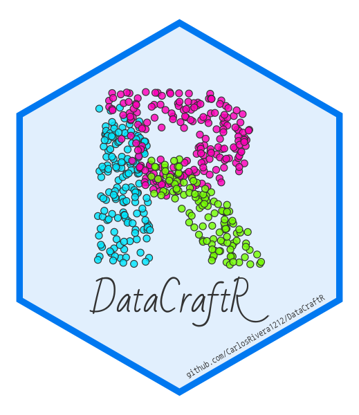

# DataCraftR 

**DataCraftR** turns a drawing into a data set. Sketch a scatter plot, a
histogram, a smooth density curve, a bivariate normal ellipse, a regression
curve with its error band, a radar profile per group, a boxplot, a set of
count bars or a contingency table in an interactive gadget, press **Done**,
and get a `data.frame` back, together with a reproducible specification that
regenerates the same data.

It is meant for teaching and for testing algorithms: you decide the shape of
the data, and R gives you the numbers.

> **Inspired by**: [drawdata](https://github.com/koaning/drawdata)
> **Powered by**: [Shiny](https://shiny.posit.co/) and [D3](https://d3js.org/)
> (D3 is bundled, so the tools work offline)

## Installation

```r
# CRAN
install.packages("DataCraftR")

# Development version from GitHub
# install.packages("remotes")
remotes::install_github("CarlosRivera1212/DataCraftR")
```

## The tools

| Function | What you draw | What you get | Main arguments |
|---|---|---|---|
| `dcr_scatter()` | Points for up to 10 groups (spray, place, erase) | Exactly the drawn points: `x`, `y`, `group` | `xlim`, `ylim`, `groups`, `names` |
| `dcr_count()` | Integer counts for every variable and category | Exactly those counts, one row per observation (`variable`, `category`) | `variables`, `categories`, `ymax` |
| `dcr_mosaic()` | A mosaic of two categorical variables (drag column borders and cuts) | Exactly N rows, two factors (`exposure`, `outcome`); live chi-square in the gadget | `cols`, `rows`, `n`, `names` |
| `dcr_boxplot()` | Q1, median and Q3 of one box per variable | A random sample matching those quartiles | `variables`, `n`, `family` (`"normal"`/`"uniform"`), `ylim` |
| `dcr_histogram()` | Bar heights for one histogram per variable | A random sample from that population | `variables`, `n`, `xlim`, `nbins` |
| `dcr_density()` | A smooth density curve per variable (soft Pull / Paint brush) | A random sample from that distribution | `variables`, `n`, `xlim` |
| `dcr_bivariate()` | One ellipse per group (Handles / Gestures) | A random sample from that bivariate normal: `x`, `y`, `group` | `groups`, `n`, `xlim`, `ylim`, `names` |
| `dcr_regression()` | One true curve and error band per group (Pull / Paint brush, equation, error-shape presets) | n random `x`, `y`, `group` rows per group around the curve | `f`, `groups`, `n`, `xlim`, `sd`, `names`, `shared_x` |
| `dcr_radar()` | One mean profile and spread band per group on a radar chart | n individuals per group, one column per variable, plus a `group` column | `variables`, `groups`, `n`, `range`, `integers`, `group_name` |

## Two ways to use them

**From the console.** Done returns the data frame; Cancel returns `NULL`.
Nothing is written to disk and no code is inserted.

```r
library(DataCraftR)
df <- dcr_scatter(xlim = c(-5, 5), groups = c("control", "treated"))
```

**From the RStudio Addins menu.** Done saves the drawing and inserts three
lines of code at the start of a new line after your cursor (in R Markdown or
Quarto outside a chunk, they go in a new `{r}` chunk; with no open document
they are run in the console):

```r
# DataCraftR · scatter · 2026-11-17 15:30 · n = 1146
df <- dcr_load("scatter_20261117_153012")
# write.csv(df, "scatter.csv", row.names = FALSE)   # save into your project
```

For boxplots, histograms, density curves, bivariate ellipses, regression
curves and radar profiles the line also carries the seed, for example
`dcr_load("boxplot_20261117_153012", seed = 42)`.

## Reproducibility

Every result carries its specification, including the seed that was used.

```r
spec <- dcr_spec(df)        # extract the spec from a result
same <- dcr_sample(spec)    # regenerate the same data
more <- dcr_sample(spec, n = 1000, seed = 1)   # population tools: resample
```

Addin drawings are stored in `tools::R_user_dir("DataCraftR", "data")`, which
persists across sessions. Manage them with:

```r
dcr_list()                  # id, tool, created, n
df <- dcr_load("boxplot_20261117_153012", n = 500, seed = 42)
dcr_delete("boxplot_20261117_153012")
```

## Future tools

In DataCraftR:

- reopen a saved drawing

In a separate missing-data package:

- NA patterns
- imputation

In a separate spatial / temporal package:

- 2D density and contours
- tile grids
- line time series
- maps

## Citation

> Rivera, C. (2026). _DataCraftR: Create Datasets Interactively Using
> 'shiny'._ R package version 0.5.6.
> <https://github.com/CarlosRivera1212/DataCraftR>

## License

GPL (>= 3). See the `LICENSE` file. D3.js is copyright Mike Bostock (ISC
license).
